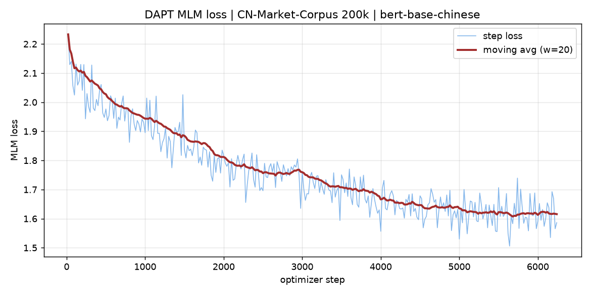

# DAPT 域自适应预训练记录（CN-Market-Corpus）

- 日期：2026-10-12
- 底座：`bert-base-chinese`（HuggingFace）
- 任务：MLM 继续预训练（masked language modeling, mask 概率 0.15）
- 产出：`ml/models/dapt_bert/`（约 409MB，已 gitignore，用脚本重新生成）

## 1. 为什么选了这条路

目标是让底座先吸收**中文金融领域**的用词与表达，再交给 LoRA 在股吧标题上做监督微调。
选 `mulfsa/CN-Market-Corpus`（Apache-2.0）作为 DAPT 语料，关键理由是它**与 LoRA 的
监督数据（东财股吧标题）不同源**，不会把测试集泄漏进预训练阶段。

> 反例：早期曾直接用 `ml/data/guba_title_all.csv`（LoRA 的训练/测试全集）跑 DAPT，
> 那会让后续 "DAPT+LoRA" 的指标被泄漏污染，已废弃该做法。

## 2. 语料构建（踩坑记录）

`CN-Market-Corpus` 仓库里实际只有两个文件：

| 文件 | 大小 | 内容 |
|---|---|---|
| `d1.csv` | 13 MB | 带标签的 D1（约 6,881 条） |
| `d2.json` | **13.78 GB** | 无标签 D2，**单个 JSON 数组，每行一条记录** |

**它不是 parquet。** 所以 `datasets.load_dataset(..., streaming=True)` 没有分片可切，
会退化成整文件下载——实测挂起 3.5 分钟零输出，只能中止。

改用 **HTTP Range 请求取文件头部**（镜像支持 `206 Partial Content`），
只下载前面 1.06 GB 即可拿到 20 万条。封装为 `ml/prepare_dapt_corpus.py`（纯标准库、可断点续传）。

记录字段：`date / source / serial_number / section / reporter / title / body`。
单条平均 4.8 KB，其中 **`title` 平均 21 字**、`body` 平均 1670 字。

**语料构成**：每条取 `title + "。" + body 前 150 字`，平均 170 字 —— 既贴近下游的短标题形态，
又带上了金融正文里的领域词汇。

| 项 | 值 |
|---|---|
| 条数 | 200,000 |
| 平均字数 | 170 |
| 文件 | `ml/data/cn_market_dapt.txt`（91.2 MB，已 gitignore） |

## 3. 训练配置

| 参数 | 值 |
|---|---|
| seq_len | 128 |
| batch_size | 16（未触发 OOM 降批） |
| gradient_accumulation | 2 |
| learning_rate | 5e-5，warmup 100 步 |
| epochs | 1 |
| 精度 | **bf16** |
| 优化步数 | 6,250 |

两点说明：

1. **用 bf16 而不是 fp16。** 本机 RTX 3060（sm_86）支持 bf16；fp16 在 MLM 上
   容易出现 `grad_norm = inf`，改用 bf16 后梯度范数稳定在 7～28。
2. `dataloader_num_workers=0`。Windows 下多进程 DataLoader 容易卡死。

## 4. 结果

| 指标 | 值 |
|---|---|
| 训练耗时 | **3,560 s（约 59 分钟）** |
| 吞吐 | 1.757 步/s |
| train_loss | 1.755 |
| loss 起点（step 20） | 2.2329 |
| loss 终点（step 6240） | **1.5862** |
| 末 10 点均值 | 1.6148 |
| 最低 loss | 1.5058 |
| 显存峰值 | 4.34 GB / 6 GB |
| GPU 利用率 | 97% |



loss 从 2.23 单调降到 1.59，后段（约 step 5000 之后）趋于平缓，没有异常尖峰或发散，
说明 1 个 epoch、5e-5 的学习率对这批语料是合适的。

## 5. 产物自检

把训练出的 `dapt_bert` 与原始 `bert-base-chinese` 放在同一组金融句子上做遮蔽词补全对比：

| 句子 | bert-base-chinese | dapt_bert |
|---|---|---|
| 证监会表示将继续推进资本市场 **[MASK]** 改革。 | 化 \| 的 \| 法 \| 制 \| 性 | 的 \| 化 \| 法 \| 性 \| 再 |
| 该公司发布业绩预告，预计上半年净利润同比大幅 **[MASK]**。 | 增 \| 降 \| 度 \| 涨 \| 减 | 增 \| 降 \| 减 \| 涨 \| 提 |

模型能正常加载、推理，给出的补全词都落在金融语境里（增/降/涨/减）。差异不大符合预期——
只有 1 个 epoch、约 2560 万 token 的轻量 DAPT，主要作用是"换口音"而非"换能力"，
真正的收益要看下游 LoRA 微调后的指标。

## 6. 复现命令

```bash
cd ml

# 1) 构建 DAPT 语料（约 1GB 流量，实测 ~2.5MB/s）
.venv/Scripts/python.exe prepare_dapt_corpus.py --max_records 200000
.venv/Scripts/python.exe prepare_dapt_corpus.py --check      # 查看语料状态

# 2) 训练（约 1 小时）
HF_ENDPOINT=https://hf-mirror.com HF_HUB_DISABLE_XET=1 \
.venv/Scripts/python.exe train_dapt.py \
  --model models/bert-base-chinese \
  --corpus data/cn_market_dapt.txt \
  --max_samples 200000 --seq_len 128 --batch_size 16 --grad_accum 2 \
  --lr 5e-5 --epochs 1 --out models/dapt_bert
```

## 7. 下一步

在 DAPT 底座上再训一版 LoRA，与现有「原始底座 + LoRA」（Acc 0.7460 / Macro-F1 0.7417）做对照：

```bash
.venv/Scripts/python.exe train_lora.py --base models/dapt_bert \
  --data data/guba_title_all.csv --out models/lora_dapt \
  --epochs 5 --batch_size 32 --lr 5e-4 --lora_r 8 --lora_alpha 16 --merge
```

这正是「DAPT 到底有没有用」的实证答案，也是实训报告里最值得写的一张表。
